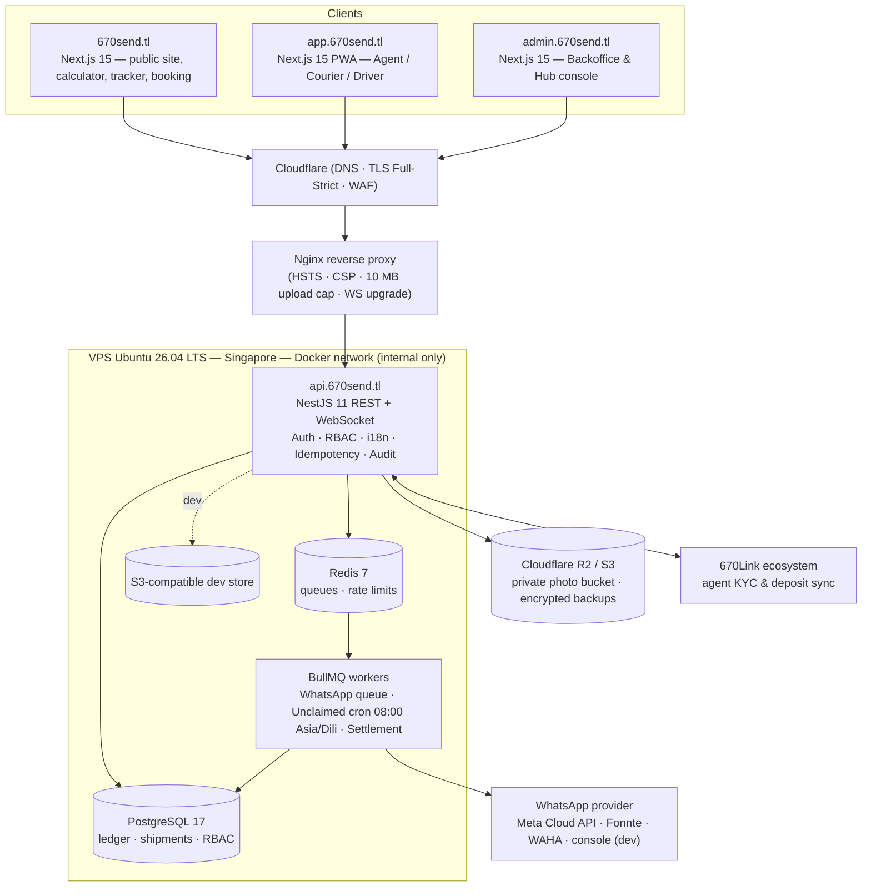
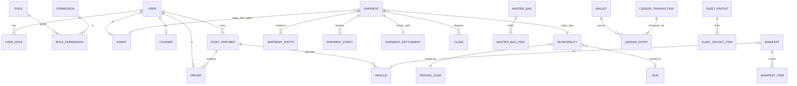
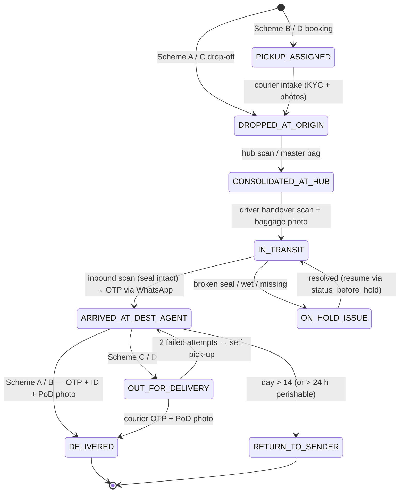

# 670Send — System Architecture (Phases 1–6)

Inter-municipality parcel logistics for Timor-Leste (14 municipalities), operated by Zovoranexia, Lda.
Hybrid model: **670Link kiosks** (drop-off / pick-up points) + **bus baggage** (≤ 10 kg) + **pickup / truck cargo**
(> 10 kg) + **ferry cargo** (Ataúro, Oecusse) + **motorbike couriers** (first / last mile).

Source of truth for business rules: `paket_dokumen_sop_mou_skema_tarif_logistik_670send.md` and the Phase-1 brief.

---

## 1. Guiding principles

| # | Principle | Where it is enforced |
|---|-----------|----------------------|
| 1 | **Money is exact.** `NUMERIC(14,4)` in PostgreSQL, `bigint` 1/10,000-USD units in code. No floats anywhere. | `schema.prisma`, `@670send/pricing` |
| 2 | **The ledger is append-only and balanced.** Every posting nets to zero; rows cannot be updated or deleted. | DB triggers in `sql/001_*` + `LedgerService` (Phase 2) |
| 3 | **Compliance is enforced twice** — API (clear localized error) *and* database (cannot be bypassed). Oecusse/Ataúro can never travel by land. | `selectTransportCanal`, trigger `enforce_sea_route_rule_shipments` |
| 4 | **Tetun first.** `tet` is the default and the fallback in every app, API error and WhatsApp message. | `@670send/i18n`, `LanguageCode` enum |
| 5 | **Evidence over trust.** KYC, 2 intake photos, baggage photo, incident photo, PoD photo — all private, signed-URL only, SHA-256 recorded. | `shipment_photos` |
| 6 | **Least privilege, scoped.** Dynamic RBAC plus ownership scoping (`agent_id` / `courier_id` / `fleet_partner_id`). | `@670send/types` permissions, Phase 2 guard |

---

## 2. System architecture



### Runtime responsibilities

| Component | Responsibility |
|-----------|----------------|
| **API** | Single writer of business state. Validates, authorizes, prices, posts ledger, emits events. |
| **Workers** | Sends WhatsApp (dedupe key per message), storage reminders (Day 3/5), storage penalty accrual (Days 6–14), RTS flagging (> 14 days / > 24 h perishable), settlement release. |
| **PostgreSQL** | System of record. Triggers guard immutability, balance and sea-route rules. |
| **Redis** | BullMQ queues + rate-limit counters only — never the system of record. |
| **Object storage** | Private bucket; the API issues 300-second signed URLs. |

---

## 3. Monorepo layout

```
670send/                          (repo root = Apps/)
├── apps/
│   ├── api/                      NestJS 11 + Prisma            ← Phase 1 (db) · Phase 2-4 (code)
│   │   ├── prisma/
│   │   │   ├── schema.prisma     39 models, 38 enums
│   │   │   ├── seed.ts           reference + demo data (idempotent)
│   │   │   ├── sql/001_integrity_and_immutability.sql   (source of the guard migration)
│   │   │   └── migrations/       init + integrity_guards
│   │   └── prisma.config.ts
│   ├── web/                      Next.js 15 — 670send.tl        ← Phase 5
│   ├── pwa/                      Next.js 15 PWA — app.670send.tl ← Phase 6
│   └── admin/                    Next.js 15 — admin.670send.tl   ← Phase 7
├── packages/
│   ├── types/        @670send/types       enums · geography (14 municipalities, hubs) · RBAC catalog
│   ├── validation/   @670send/validation  Zod: +670 phone, waybill, OTP, PIN, KYC, prohibited checklist
│   ├── pricing/      @670send/pricing     pure rules: weight, canal, insurance, liability, money math
│   └── i18n/         @670send/i18n        tet · pt · en · id dictionaries + 44 WhatsApp templates
├── infra/                        nginx · compose · scripts      ← Phase 8
├── docs/                         this file
├── brand/                        logo.svg · logo-icon.svg (+ reversed)
├── docker-compose.dev.yml        Postgres 17 · Redis 7 · S3Mock (127.0.0.1, high ports)
├── turbo.json · pnpm-workspace.yaml · tsconfig.base.json · .env.example
```

Shared packages are built with `tsup` (ESM + CJS + d.ts) so NestJS (CJS), Next.js (ESM) and `tsx` all consume the same output.
Turbo orders `^build` before `dev`, `test`, `typecheck`, `db:seed`.

---

## 4. Data model (overview)



Notable design choices beyond the brief's field list (all additive):

* `ledger_transactions` header table so a posting is provably balanced (`Σ credits = Σ debits`).
* `shipment_settlements` — the idempotent per-shipment record of the 40/25/15/15/5 split and whether it is `HELD` or `RELEASED`.
* `master_bag_items`, `inbound_incidents`, `fleet_payout_items`, `waybill_sequences`, `idempotency_keys`, `system_settings`.
* `shipments`: `pricing_snapshot` (disputes are judged on the tariff used at intake), `status_before_hold`, `version` (optimistic lock), OTP attempt/lock counters, unclaimed-cron timestamps, `intake_channel`.
* Photos store a **private storage URI** in `file_url` (never a public link) plus `sha256`.

---

## 5. Shipment lifecycle (9 states)



Every transition writes one immutable `shipment_events` row and (where defined) one idempotent notification job.

---

## 6. Financial ledger

### 6.1 Wallets

| Owner | Wallet types |
|-------|--------------|
| Agent (`AGENT`) | `DEPOSIT`, `COMMISSION` |
| Courier (`COURIER`) | `DEPOSIT`, `COURIER_EARNINGS` |
| Fleet partner (`FLEET_OWNER`) | `FLEET_PAYABLE` |
| System (`owner_id = 'SYSTEM'`) | `PLATFORM_REVENUE`, `PLATFORM_HUB_OPS`, `CLAIM_ESCROW_RESERVE`, `INSURANCE_POOL`, **`PENDING_SETTLEMENT`**, **`EXTERNAL_CLEARING`** |

`PENDING_SETTLEMENT` and `EXTERNAL_CLEARING` are the two wallet types added to the brief's list. Without them a posting
cannot be balanced: money held until delivery needs a home, and money entering/leaving the system (bank, cash,
MOSAN/T-Pay) needs a counter-party. `EXTERNAL_CLEARING` is the only wallet allowed to go negative.

Global invariant (verified on the seeded database): **Σ all wallet balances = 0** and **every wallet balance = Σ its ledger entries**.

### 6.2 Worked example — Scheme A, 2 kg Díli → Baucau, fee F = $4.00, dropped at an origin kiosk

| Moment | Debit | Credit |
|--------|-------|--------|
| **Intake** (customer pays cash $4.00 to the agent) | Origin agent `DEPOSIT` **$3.40** (= F − 15%) | `PENDING_SETTLEMENT` $1.60 (fleet 40%) · `PENDING_SETTLEMENT` $0.60 (destination 15%) · `PLATFORM_REVENUE` $1.00 (25%) · `CLAIM_ESCROW_RESERVE` $0.20 (5%) |
| **Release** (`DELIVERED`: OTP + PoD) | `PENDING_SETTLEMENT` $2.20 | Fleet owner `FLEET_PAYABLE` $1.60 · Destination agent `COMMISSION` $0.60 |
| **Fleet payout** (weekly batch, approved by Finance) | Fleet `FLEET_PAYABLE` | `EXTERNAL_CLEARING` (bank / MOSAN reference stored) |
| **Deposit top-up** (approved by Finance) | `EXTERNAL_CLEARING` | Agent `DEPOSIT` |
| **Claim payout** (from escrow) | `CLAIM_ESCROW_RESERVE` | `EXTERNAL_CLEARING` |

The origin agent's own 15% ($0.60) is the cash they keep — it never enters the ledger, exactly as in the SOP
("agent keeps cash + instant 15% profit"). If the parcel was taken at a company hub or by a courier, that 15% is
credited to `PLATFORM_HUB_OPS` instead (`origin_mode = HUB_OPS`).

### 6.3 Concurrency & idempotency

* `SELECT … FOR UPDATE` on the wallets of a posting, locked in `id` order (no deadlocks); `version` incremented on each write.
* `Idempotency-Key` on every financial / intake endpoint → `idempotency_keys` (scoped per caller, request-hash checked) and `ledger_transactions.idempotency_key` (UNIQUE) as the last line of defense.
* Seed already uses this exact pattern (see `postDemoTopUp`) and it was run twice against PostgreSQL 17 without double-posting.

---

## 7. RBAC

* Tables: `roles`, `permissions`, `role_permissions`, `user_roles`. Keys are `module:action`; `*:*` is the Super Admin wildcard; `_own` permissions additionally require an ownership match.
* The default matrix lives in `@670send/types` (`ROLE_PERMISSIONS`) so the **seed, the NestJS guard and the web/pwa/admin route guards share one definition**.
* Seeding is additive: re-running never removes a grant an administrator added.
* Segregation of duties is tested in `packages/types`: Ops cannot approve deposits or payouts; Finance cannot override tracking status; Driver sees no money.

---

## 8. Internationalisation

* Locales: `tet` (default + fallback) · `pt` · `en` · `id`, 9 namespaces: `common web pwa admin status errors receipt terms prohibited`.
* `@670send/i18n` — typed dictionaries (Tetun defines the shape; TypeScript fails the build if another locale drifts, and a test asserts identical key sets and non-empty values) and the **44 WhatsApp templates** (9 states + Day-3 + Day-5, × 4 languages).
* WhatsApp bodies are stored in `notification_templates` (unique per event + language) so staff can edit them without a deploy. Allowed `{{variables}}` per event are declared in `NOTIFICATION_VARIABLES`; a test enforces that all 4 languages use the same variables and that the OTP message always contains `{{otp}}`.
* Locale switcher state: cookie `670send_lang` + `localStorage` + `users.preferred_lang` (when signed in).
* Per-shipment `sender_lang` / `recipient_lang` choose the language of every outgoing message.

---

## 9. Security decisions worth knowing

| Topic | Decision |
|-------|----------|
| Pickup OTP | 6 digits is only 1,000,000 values — a plain hash is brute-forced offline instantly. Stored as **HMAC-SHA256 with a server-side pepper** (`OTP_PEPPER`), 5 attempts then lock, expiry 15 days. |
| OTP in logs | `notification_logs.rendered_body` stores the OTP **masked**; `shipment_events.meta` never contains it. |
| Tokens | 15-min access JWT, rotating refresh tokens stored as SHA-256 hashes with family revocation on reuse. |
| Passwords / PIN | Argon2id; PIN lockout after 5 failures; weak PINs (`123456`, `000000` …) rejected in `@670send/validation`. |
| Bank details | `fleet_partners.bank_account_details` encrypted at application level (AES-256-GCM, `FIELD_ENCRYPTION_KEY`). |
| Photos | Private bucket, 300 s signed URLs, SHA-256 per file, client-side compression < 200 KB for 3G. |
| Network | DB / Redis never published; dev compose binds to `127.0.0.1` on high ports. |
| Public endpoints | Tracker masks names; per-IP rate limits; booking requires phone verification (`phone_verified_at`). |

---

## 10. What was verified in Phase 1

Run on this machine against a real **PostgreSQL 17** container:

* `prisma validate` ✔ · migrations `init` + `integrity_guards` apply cleanly ✔
* Seed runs twice, idempotent ✔ — 14 municipalities, 4 hubs, 4 zones, 4 add-ons, 8 roles, 71 permissions, 44 templates, 6 system wallets, 9 users, demo wallets funded via a real balanced ledger posting.
* Guards rejected, as intended: `UPDATE`/`DELETE`/`TRUNCATE` on the ledger · an unbalanced ledger transaction · a negative deposit · Díli→Oecusse by bus · a non-sea route on the ferry canal · a shipment without the prohibited-items confirmation. A valid shipment was accepted.
* Package tests: `types`, `validation`, `pricing` (14), `i18n` (68) — all green; `tsc` clean on all five workspaces.

**Not done in Phase 1** (by design, later phases): NestJS application code, HTTP endpoints, the three Next.js apps, Dockerfiles / Nginx / hardening scripts. The seed's `postDemoTopUp` is a minimal prototype of the Phase-2 `LedgerService`.

---

## 10b. Phase 2 — Backend core (what exists now)

`apps/api/src` (NestJS 11, CommonJS build via `nest build`; conventions in `apps/api/README.md`):

| Module | What it does |
|--------|--------------|
| `config` | Zod-validated environment, **fails at boot listing every bad variable**; in production it refuses placeholder secrets, identical access/refresh secrets, `S3_AUTO_CREATE_BUCKET`, or an empty CORS list. |
| `auth` | `POST /v1/auth/login` (email + password), `/login/pin` (phone + 6-digit PIN, **field roles only**), `/refresh`, `/logout`, `GET /me`, `PATCH /me/language`, `/password/change`, `/pin/change`. Argon2id; 15-min HS256 access JWT (issuer + audience pinned); opaque refresh tokens stored as **HMAC hashes**, rotated on every use, **reuse of a rotated token revokes the whole session family**; 5 failures → 15-min lock; identical error and timing for "unknown account" and "wrong password". |
| `rbac` | `ActorService` rebuilds roles / permissions / ownership scope (`agentId`, `courierId`, `driverId`, `fleetPartnerId`) from the DB (30 s cache, instant invalidation). `PermissionsGuard` is **deny-by-default**; `*:*` and `module:*` wildcards; `canAccess()` implements every `_own` permission and answers 404 (not 403) for other people's resources. A `must_change_password` account can do nothing except change its password. |
| `i18n` | `nestjs-i18n` fed by a custom loader from `@670send/i18n`. Locale precedence: **`X-Lang` header (instant switcher) → saved `preferred_lang` → `Accept-Language` → Tetun**. A browser's automatic `Accept-Language` can never override a signed-in user's choice. Every error is `{ statusCode, code, message(localized), details?, requestId }`. |
| `audit` | `@Audit(action, entity)` interceptor writes immutable rows (actor, roles, ip, user-agent, request id, before/after, reason) with **secret redaction** (`password pin otp token secret hash …`). `@AuditReasonRequired()` for force-overrides. Auth events and `AUTHZ_DENIED` are audited. |
| `idempotency` | `@Idempotent()` — `Idempotency-Key` header, scoped per caller, request-hash checked: same key + same body **replays the stored response** (handler not re-run, audit not duplicated); other body → 422; concurrent duplicate → 409 `request_in_progress`; handler failure releases the key. 24 h TTL. |
| `ledger` | `LedgerService.post()` — balanced, idempotent, `SELECT … FOR UPDATE` in id order, no overdraft / no spending of `locked_balance`, joins the caller's transaction (`tx`) or retries on deadlock; `reverse()`; `reconcile()`. |
| `storage` | S3/R2 client; `POST /v1/uploads/photos` stages a photo (magic-byte sniffing — the client MIME type is never trusted — size cap, SHA-256, per-photo-type permission, private key `photos/<user>/<yyyy>/<mm>/<uuid>.<ext>`); `GET …/:id/url` gives the uploader a 300 s signed URL. `UploadsService.consumeForShipment()` is the **2-photo intake gate** for Phase 3: it atomically claims the uploads, refuses a waybill unless `OPEN_BOX_CONTENT` + `SEALED_PARCEL` are present, and cannot reuse or steal another user's photos. |
| `health` | `GET /v1/health` (liveness), `/v1/health/ready` (database). |

Cross-cutting: per-IP rate limits (general + a stricter bucket for auth routes), `helmet`, CORS allow-list, `trust proxy`, `X-Request-Id` on every response, no stack traces in responses.

Schema change: new table `staged_uploads` (photos are uploaded *before* the shipment and waybill exist).

### Verified in Phase 2

* **82 automated tests, all green**, against a real PostgreSQL 17 test database (`<db>_test`, created / migrated / seeded automatically; the dev database is never touched):
  * *Ledger (14)* — exact before/after balances; unbalanced / zero / negative / > 4-decimal amounts refused; overdraft refused with no trace; idempotent replay; key reuse with another amount refused; **12 parallel debits of $30 against $100 → exactly 3 succeed, balance $10**; 6 parallel requests with one key → one transaction; multi-party split; reverse (itself idempotent); locked balance; rollback together with the caller's transaction; DB-level immutability; clean `reconcile()`.
  * *Auth* — login, localized + identical errors, lockout and unlock, inactive accounts, PIN login (incl. refusal for backoffice roles), forged / wrong-audience / expired / `alg:none` tokens, rotation, **theft detection**, hashed-at-rest refresh tokens, logout, language precedence, password / PIN policy, audit trail without secrets.
  * *RBAC + audit + idempotency* — wildcard, forbidden, deny-by-default, ownership scope (404), suspended agent loses scope, role change after cache invalidation, `must_change_password`, redacted audit rows, reason-required overrides, replay / conflict / scope / concurrency / failure-release / expiry.
  * *Uploads + unit* — magic bytes beat fake MIME types, size cap with localized limit, per-role photo types, signed URLs owner-only, the 2-photo gate (missing type, reused, foreign, rolled-back), env validation, redaction, canonical JSON, ownership logic.
* Real HTTP smoke test of the built server: health, localized 401s (pt / tet), Super-Admin login with `*:*`, and a **real S3 round trip** (upload → signed URL → byte-identical download).

### Limits worth knowing

* An access token stays valid until it expires (15 min) after logout; the refresh token is what is revoked. Deactivation / role change cut a user off within 30 s (instantly on the same instance).
* The dev S3 (S3Mock) **does not enforce signatures** — the "private bucket" guarantee must be re-checked against real R2 with *public access disabled* before launch (Phase 8 checklist).
* **MinIO no longer publishes public Docker images**, so the brief's optional "self-hosted MinIO" is not a safe default. Production = Cloudflare R2; if you need self-hosted S3 choose SeaweedFS / Garage / RustFS and verify the image source first.
* Audit rows written by the interceptor are fire-and-log (a failed audit write is logged but does not fail an already-committed request); security-critical mutations should use `AuditService.writeInTx()` so the change and its audit row commit together (Phase 3 does).
* Rate limiting is in-memory (single API instance). Move the Throttler store to Redis if the API is ever scaled out.

---

## 10c. Phase 3 — Logistics engine (what exists now)

`apps/api/src/logistics` + `src/notifications` (all behind the Phase-2 guards, audit and idempotency).

### Endpoints

| Area | Endpoints | Who |
|------|-----------|-----|
| **Public** | `POST /v1/public/quote` · `GET /v1/public/track/:waybill` · `POST /v1/public/pickup-bookings` | anyone (rate-limited) |
| **Intake** | `POST /v1/shipments` (Idempotency-Key) · `GET /v1/shipments` · `GET /v1/shipments/:ref` (+`/events`) | agent, courier, hub desk · read: scoped |
| **Print** | `GET /v1/shipments/:ref/receipt` · `/label` — `?lang=tet\|pt\|en\|id` · `?format=json\|escpos\|text` | `shipments:print_label` |
| **Hub** | `POST /v1/hub/receive` · `POST/GET /v1/master-bags` · `…/:code/items` · `…/:code/seal` | hub staff; courier hands over own pick-ups |
| **Manifests** | `POST/GET /v1/manifests` · `…/:code/ready` · `/cancel` · `/handover` (driver) · `/arrive` (driver) | ops · driver · fleet owner (read) |
| **Inbound** | `POST /v1/inbound/scan` · `GET /v1/incidents` · `…/:id/driver-confirm` · `…/:id/resolve` | destination agent · driver · CS |
| **Delivery** | `POST /v1/pod/verify` · `GET /v1/shipments/:ref/storage-fee` · `POST …/resend-otp` · `…/out-for-delivery` · `…/delivery-failed` · `GET /v1/courier/jobs` | agent · courier |
| **Bookings** | `GET /v1/pickup-bookings` · `…/:id/confirm` · `/assign` · `/cancel` | ops |

### Intake is one atomic transaction

KYC schema → PIN re-confirmation → prohibited-items gate (all 7 lines `true`) → price + canal → destination agent → **waybill sequence → shipment → 2-photo gate → ledger posting → settlement → timeline event → audit row**. Any failure rolls back everything: no shipment, no burned photo, no money moved, **no gap in the waybill numbers**. Messaging happens after commit and can never undo it.

### Money flows (verified to the cent in the tests)

| Moment | What moves |
|--------|-----------|
| **Intake** (collector = whoever took the cash) | Collector's wallet **debited by what they do not keep**: kiosk keeps its 15 % · courier keeps 80 % of the pick-up fee · company hub desk keeps nothing. Credits: fleet 40 % + destination 15 % + delivery-courier 80 % → `PENDING_SETTLEMENT`; platform 25 % (+ 20 % of add-ons) → `PLATFORM_REVENUE`; 5 % → `CLAIM_ESCROW_RESERVE`; premium → `INSURANCE_POOL`; origin 15 % → `PLATFORM_HUB_OPS` when no kiosk took the parcel. |
| **Intact arrival** (inbound scan) | Fleet 40 % → the fleet **owner's** `FLEET_PAYABLE` wallet (never the driver; MoU Art. 4). Fleet beneficiary is fixed at manifest handover. |
| **DELIVERED** (OTP + ID + PoD photo) | Destination 15 % → agent `COMMISSION` (setting `dest_commission_wallet` can switch to `DEPOSIT`) · delivery courier's 80 % → `COURIER_EARNINGS`. |
| **Storage penalty** (Day 6–14, $0.50/day) | Collected in cash at hand-over; collector keeps 70 %, platform's 30 % is debited from their deposit. |

Worked example (Scheme A, 2 kg Díli → Baucau, $4.00): kiosk debited **$3.40**; pending +$2.20; revenue +$1.00; escrow +$0.20 — then fleet owner +$1.60 on arrival and destination agent +$0.60 on delivery. Shares are integer units, rounded down, the platform takes the remainder, so the five parts always equal the fee exactly (also enforced by a DB constraint).

### Pricing & canal

`measureParcel` → tier `DOCUMENT` (≤ 0.5 kg doc) / `SMALL` (≤ 10 kg, ≤ 40×30×30 cm in any orientation, not fragile) / `CARGO`. Fee = zone table (DB, admin-editable) + per-kg + municipality surcharge (Oecusse +$2). Canal: bus baggage, cargo pickup, or **sea ferry (forced for Ataúro / Oecusse)** — enforced in `PricingService`, in `ManifestsService`, and by DB triggers. Add-ons: motorbike pick-up/delivery $1.50, cargo $5.00 (Díli only); **wholesale**: ≥ 3 parcels on one pick-up booking pay the pick-up once (or free via the admin toggle).

### Manifests & fleet safety

A manifest needs: partner `ACTIVE` with an in-date MoU · vehicle with valid **DNTT permit and KIR** · driver with a valid **licence** · everything belonging to the same company · vehicle type matching the canal (bus / truck / ferry) · sealed bags or consolidated loose parcels for the right corridor hub · **bus cap** (default 20 small parcels and 2 master bags, setting `bus_capacity`). Permits are re-checked at *ready* and again at the driver's handover. A bus trip cannot leave without the **baggage-compartment photo**; a ferry needs the official **port manifest number**.

### Inbound, incidents, OTP

Intact → `ARRIVED_AT_DEST_AGENT`; 6-digit OTP generated (HMAC-SHA256 with a server pepper, bound to the shipment), WhatsApp'd to the recipient in their language; the OTP never appears in logs or in Redis in clear text (AES-GCM payloads, masked log body). Damaged / wet / missing → `ON_HOLD_ISSUE`, **mandatory incident photos**, one incident per parcel, the **driver must confirm digitally** before CS can resolve (release to recipient, with `fleetLiable` deciding whether the fleet's 40 % is released, or return to sender). Wrong OTP: 5 tries → 15-minute lock (counted even when the request aborts).

### Unclaimed-parcel worker (BullMQ, Redis)

Registered idempotently on every boot: **daily 08:00 Asia/Dili** and **hourly** (perishables). Day 1 = arrival day (Dili calendar days). Day 3 & Day 5 reminders to recipient *and* sender, once; Day 6–14 penalty accrues as an absolute value (idempotent); Day 15 → `RETURN_TO_SENDER` + ops alert; food flagged short-shelf-life → return after 24 h. Catch-up safe after an outage.

### WhatsApp

`IWhatsAppAdapter` with Meta Cloud API, Fonnte, WAHA and a console sandbox. Templates live in the DB (4 languages, editable without deploy), fall back to the same language's built-in text, strip unresolved placeholders, are logged with the OTP masked, deduplicated by key, retried 5× with exponential backoff, and can never fail the parcel operation that triggered them.

### Receipts

58 mm ESC/POS (32 columns, CP858 so í ã ç é ó ú print correctly, native QR) in Tetun / Portuguese / English / Indonesian, switchable per print (`?lang=`, default = X-Lang → user preference → sender language). Returned as JSON (text + base64 bytes), raw bytes (`format=escpos`, for Web Bluetooth or RawBT) or plain text (WhatsApp share).

### Verified in Phase 3

* **181 API tests green** on a fresh PostgreSQL test database created per run (plus 68 i18n, 27 pricing, validation and types tests). New suites: intake (32), end-to-end flow (6), incidents (5), fleet + sea (14), unclaimed worker + door delivery (10), receipts + ESC/POS (11), notifications + adapters (18), BullMQ on **real Redis** (3).
* Highlights: exact money at every stage and `reconcile()` clean after each; 5 parallel intakes get gap-free distinct waybills; atomic rollback on insufficient deposit / missing photo; OTP lock-out; hold → driver confirm → release; Oecusse refused for bus/truck in 4 languages and by the database; expired MoU / DNTT / KIR / licence refused; bus cap; storage-fee collection and 70/30 split; the cron path through real BullMQ; payloads in Redis unreadable.
* Real-stack smoke test of the built server: Postgres + Redis worker + S3 photos → intake → receipt → public tracker → both WhatsApp messages in their own language.

### Decisions taken (defaults) and open items for Phase 4

* **Courier money model:** the courier keeps cash for their share and is debited the rest from a pre-funded deposit (same as kiosks).
* **Hub-desk intake** (cash to the company) is limited to staff holding `master_bags:manage` **and** `shipments:create`, i.e. Super Admin today; give Ops that permission if desks are staffed by Ops.
* **Delivery add-on not used** (parcel collected at the kiosk after 2 failed door deliveries): the courier's 80 % is parked in `PLATFORM_REVENUE` with an `ADJUSTMENT` entry — **refund policy needed** (Phase 4 Finance).
* **Return-to-sender settlement:** the destination agent's 15 % and any storage penalty stay in `PENDING_SETTLEMENT` / unpaid until Phase 4 defines RTS economics (refund to sender? pay the kiosk for storage?).
* **Fleet 40 % on incidents:** held while the fleet may be liable (`fleetLiable` default true); the claim engine in Phase 4 decides and deducts from payouts.
* A kiosk whose deposit cannot cover the platform's 30 % of a storage penalty cannot complete a hand-over (insufficient_deposit) — kiosks must keep a small float.
* Geo rules (≤ 5 km radius for motorbike add-ons) are **not enforceable** without geocoding; the courier is trusted and the booking carries the coordinates.
* Booking phone verification is by **ops call-back** (`confirm`); automatic WhatsApp-OTP verification arrives with the web app (Phase 5).
* No webhook for provider delivery receipts yet (log shows SENT, not DELIVERED/READ).

*(The RTS-economics, delivery-add-on-refund and fleet-liability items above are resolved in Phase 4 — see §10d.)*

---

## 10d. Phase 4 — Admin, finance & claims (what exists now)

`apps/api/src/admin` — one module, 8 services, 3 controllers, all behind the Phase-2 guards, audit trail and idempotency. Everything below is enforced **server-side by permission**, never by hiding UI.

### Endpoints

| Area | Endpoints | Who |
|------|-----------|-----|
| **Deposits** | `POST/GET /v1/deposits/requests` (Idempotency-Key; proof photo `DEPOSIT_PROOF` for non-cash, unique reference) · `GET /v1/finance/deposits/:id/proof` · `…/approve` · `…/reject` | agent / courier request · Finance decides |
| **Wallets & ledger** | `GET /v1/wallets/me` · `…/:id/statement` · `GET /v1/finance/wallets` · `/ledger` · `/reconciliation` | own · Finance |
| **Refund** | `POST /v1/finance/refunds` — unused door-delivery add-on (delivered at kiosk, or RTS received at hub) | `refunds:issue` (Finance) |
| **Payouts** | `POST /v1/finance/payouts/generate` · `GET …` · `…/:id/statement(.csv)` · `…/submit` · `…/approve` · `…/pay` · `…/fail` · `…/cancel` · `GET /v1/finance/fleet-partners/:id/bank-details` | `payouts:create` prepares · `payouts:approve` approves/pays |
| **Fleet portal** | `GET /v1/fleet/me` · `/fleet/payouts` · `/fleet/earnings` · `/fleet/payouts/:id/statement` | fleet owner, own company only |
| **Claims** | `GET /v1/claims/liability/:waybill` (cap calculator) · `POST /v1/claims` · `…/:id/evidence` · `…/review` · `…/decision` · `…/finance-approve` · `…/pay` · `…/recover` | CS files/decides · Finance co-approves & pays |
| **RTS / CS tools** | `GET /v1/rts` · `…/:waybill/received` · `…/hand-back` · `POST /v1/shipments/:waybill/reminders` · `POST /v1/admin/shipments/:waybill/override-status` | CS / Ops · override: Super Admin |
| **RBAC & staff** | `/v1/admin/roles` · `/permissions` · `/users` (+ `roles`, `deactivate`, `activate`, `reset-credentials`, `unlock`) · `/audit-logs` | Super Admin (`users:manage` for users) |
| **Content** | `/v1/admin/templates` (list, edit, preview, reset) · `/notification-logs` · `/tariffs` (zones, add-ons, municipality surcharge) · `/settings` | Super Admin · Finance (tariffs) · CS (logs) |
| **Directory** | `/v1/admin/agents` · `/couriers` · `/fleet-partners` (MoU, bank, status) · `/v1/fleet/vehicles` · `/fleet/drivers` · `/v1/admin/vehicles/:id/verify` · `/drivers/:id/verify` · `/compliance/alerts` | Ops (fleet, couriers) · Super Admin (agents) · owner (own fleet) |
| **Analytics** | `GET /v1/analytics/executive` · `/volume` · `GET /v1/reports/{shipments,ledger,claims,deposits}.csv?from=&to=` | `dashboard:view` · `reports:export` (+ the underlying read right) |

### Maker-checker applies to people, not roles

A deposit **creator ≠ approver**, a payout **preparer ≠ approver**, and a claim above the CS limit needs a **second person from Finance**. A user holding several roles still cannot approve their own work (tested with a multi-role user).

### Deposits
Cash needs no proof; bank / MOSAN / TPay transfers need a reference (unique per channel, case-insensitive; a rejected request does not block re-use) and a proof photo that must belong to the requester and is consumed once. Approval is a conditional `PENDING → APPROVED` update plus one ledger transaction `EXTERNAL_CLEARING → DEPOSIT` keyed `deposit:<id>`, so a double click or a retry can never credit twice.

### Fleet payouts
`generate` collects every **released, unpaid** fleet share (`fleetReleasedAt < period end`) for a partner (or all partners on their own cycle), minus **claim deductions** for incidents where the fleet was liable. A partial unique index guarantees a parcel is paid **once**, ever. `DRAFT → PENDING_APPROVAL → APPROVED → PAID`. A bank transfer that bounces is marked `FAILED` and stays retryable (`FAILED → PAID`, parcels remain claimed); only `CANCELLED` frees the parcels for the next run. Paying posts `FLEET_PAYABLE → EXTERNAL_CLEARING`. Statements are JSON or CSV (BOM, formula-injection safe). Daily/weekly drafts are created automatically at **06:00 Asia/Dili** by a technical system user (`system@670send.internal`, inactive, cannot log in) — they still need a human to submit and a different human to approve. Bank details are AES-GCM encrypted, masked in every read, and the full number is revealed only to `payouts:approve`, **audited every time**.

### Claims engine
* **Liability cap calculator:** insured parcel → `min(declared, $500)`; uninsured → `min(10 × base shipping fee, $50)`. Requested amount above the cap is refused; the sum of claims on a parcel can never exceed it.
* **Hand-over window:** a claim after hand-over must be filed within `claim_handover_window_minutes` (default 60).
* **Approval:** CS up to `claim_cs_approval_limit_usd` ($25); above it the claim stays `INVESTIGATING` until a Finance user co-approves.
* **Payment:** insured claims are paid **from `INSURANCE_POOL` first**, then `CLAIM_ESCROW_RESERVE`; uninsured from escrow. An empty reserve refuses payment (`escrow_insufficient`) instead of going negative.
* **Recovery:** from a liable agent or courier **deposit** (partial, retryable, never below zero) or from the fleet via payout deductions.
* Evidence is shown in a fixed order (open-box, sealed parcel, baggage, incident, PoD) with short-lived signed URLs.

### Return-to-sender economics (resolves the Phase 3 open item)
When the returned parcel is **received at the Dili hub**: the destination agent's 15 % is released (they received and stored it for 14 days), the unpaid storage penalty is **written off** (no ledger entry — the platform bears it), and an unused door-delivery add-on becomes refundable by Finance. Hand-back to the sender requires the sender's ID (or a recorded representative).

### Governance rules worth knowing
* **RBAC guard rails:** `SUPER_ADMIN` is locked (cannot be edited or deleted), the `*:*` wildcard exists only for it, system roles cannot be deleted, a role in use cannot be deleted, nobody edits their own roles or deactivates themselves, and the **last active Super Admin can never be removed**. Permission changes take effect on the **next request** of every affected user (live tokens included). Field roles (agent, courier, fleet owner, driver) are managed through the directory so a kiosk can never be created without its compliance record.
* **Template guard:** unknown variables are refused per event; a pickup message **must** contain `{{otp}}`; edits are live immediately and reset restores the built-in text.
* **Settings** are a whitelist of values the code really reads (`bus_capacity`, `claim_cs_approval_limit_usd`, `claim_handover_window_minutes`, `dest_commission_wallet`, `otp` with 6 digits fixed); structural settings such as the revenue split are read-only by design.
* **Tariff edits apply to future shipments only** — each shipment keeps its pricing snapshot and its settlement split.
* **Status override:** reason mandatory (body or `X-Audit-Reason`), changes tracking only, never moves money, and **never to or from DELIVERED**.
* **Compliance:** an agent is activated only with the signed adendum, a digital scale and secure storage; a fleet partner only with an in-date MoU, a MoU number and payout details; vehicles and drivers are created inactive and verified by Ops against in-date DNTT / KIR / licence (an owner editing permits sends the vehicle back to verification). Suspensions need a reason and bite on the **very next request**. `/compliance/alerts` lists everything expired, expiring, missing, or low on float.
* **Reconciliation** checks the ledger identity plus an invariant: `PENDING_SETTLEMENT` equals the sum of shares not yet released on shipment settlements — a drift means money is stuck or invented.

### Verified in Phase 4
* **New suites (108 tests, real PostgreSQL):** finance (21) · claims (22) · payouts (14) · access + content (24) · directory, CS tools & analytics (27).
* **Whole repo: 18 API suites, 289 API tests green** (plus the package tests); build + typecheck clean across all 15 turbo tasks, including BullMQ on real Redis.
* Real-stack smoke test of the built server on the dev stack (PostgreSQL + Redis + S3): all admin / finance / claims / analytics routes answer, RBAC fences return 403/401, the CSV carries its BOM, `reconciliation` is `ok` on the dev ledger, and the three schedulers (`unclaimed-daily`, `perishable-hourly`, `payout-drafts-daily`) are registered in Redis.
* Bugs the tests found and fixed on the way: PATCH of one kiosk flag silently reset the other (zod `.default()` re-applied by `.partial()`); the agent-code counter collided with seeded `AG-BCU-001`; a fresh fleet owner's `/wallets/me` was empty (wallets are now created lazily); the override endpoint ignored the `X-Audit-Reason` header.

### Decisions taken (defaults) and open items for Phase 5+
* **`agents:manage` is Super Admin only** (Ops can read agents and manage couriers / fleet). Give Ops the permission in the Role Matrix if kiosk onboarding is theirs.
* Payout payment is **recorded**, not executed: the transfer itself happens at the bank / MOSAN; Finance records the reference. No bank API integration.
* Claim recovery from an agent whose deposit is short is **partial** and can be retried; a write-off decision (and its approval) is not modelled yet.
* CSV exports are capped (50,000 shipments / claims / deposits, 100,000 ledger rows per request) — use narrower date ranges, or ask for streaming exports later.
* A suspended kiosk keeps read access to its own wallet (it must be able to see what it owes) but cannot take or deliver parcels.
* The executive dashboard is computed live from PostgreSQL; add materialised daily snapshots if it ever gets slow.

---

## 10e. Phase 5 — Public web `670send.tl` (what exists now)

`apps/web` — Next.js 16 (App Router), next-intl 4, Tailwind 4, Leaflet. Full guide: [apps/web/README.md](../apps/web/README.md).

### Pages (all four languages, statically generated)

| Page | What it does | API it uses |
|------|--------------|-------------|
| `/{lang}` landing | Hero + quick tracker (plain GET form), four service schemes, how it works, trust points, 14 municipalities by corridor | — |
| `/{lang}/calculator` | **Live** price and canal: total, breakdown, ETA in the visitor's language, bus / cargo / **sea ferry** (Ataúro, Oecusse) | `POST /v1/public/quote` |
| `/{lang}/track?no=` | Public tracker: masked names, 9-state timeline, hold / return banner, destination kiosk + map link | `GET /v1/public/track/:waybill` |
| `/{lang}/book` | Pick-up booking with a **map pin** (click, drag, or "use my location"), optional destination / weight, honeypot | `POST /v1/public/pickup-bookings` |
| `/{lang}/prohibited` · `/terms` | Server-rendered legal pages; terms gained two clauses (identity & hand-over, storage fees) from the SOP | — |

### Decisions

* **Language in the URL, Tetun by default.** First-time visitors always land on Tetun — `Accept-Language` is ignored on purpose (Timorese browsers are often English); a `670send_lang` cookie remembers a chosen language. WhatsApp links are now built per recipient as `/{lang}/track?no=…` (API change, tested); old links still work.
* **The browser calls the API directly**, so the per-IP rate limit applies to real visitors. Errors arrive already translated via `X-Lang`.
* **Same rules as the API on the client** (shared `@670send/validation`, same limits), so a form the site accepts is never refused for format. Every route is kept on Díli by construction.
* **Low-bandwidth and no-JS friendly:** static pages, system fonts, map code loaded only on the booking page, menus are `<details>`.
* **Security:** strict CSP (self + API + tile server), `frame-ancestors 'none'`, HSTS, no third-party scripts or cookies except the language preference.
* **Accessibility, tested:** axe-core finds no WCAG 2.2 A/AA violations in the server-rendered HTML of all 24 pages; 23 brand colour pairs are checked against 4.5:1 on the real tokens (the logo orange fails at 3.7:1, so it is decorative only).
* **Shared translations grew from 307 to 470 keys** (all four languages, parity-tested). While adding them I corrected existing Indonesian copy that used the Tetun word "Munisípiu" (now "munisipalitas").
* **Local ports moved to 3100 / 3101 / 3102** (web / PWA / admin): 3000–3010 were already used by other projects on this machine. `.env.example` and CORS follow.

### Verified in Phase 5

* **85 web tests** (jsdom, real translations, stubbed API): calculator live recalculation incl. stale-response race, route snapping, validation, API-error and network-error display; tracker (deep link, timeline, exceptions, kiosk card, copy link); booking (validation, pin, server field errors, rate limit, double-submit, honeypot, geolocation); pure logic (waybill normalisation, Díli time, bounds, phone formats); API client; colour contrast.
* **Production build, 24 pages smoke-tested:** status, `<html lang>`, distinct localized titles, one `<h1>`, hreflang ×4 + x-default, canonical, no untranslated key visible, security headers, locale routing, cookie, legacy link redirect, sitemap and robots.
* **Real stack:** a real booking went from the browser form to PostgreSQL (normalised phone, language, pin) and was removed afterwards; the calculator was driven against the live tariff (Oecusse → $8.00 by ferry); OpenStreetMap tiles load under the production CSP; no horizontal scroll at 375 px on any page.

### Open items

* **Map tiles:** the default is the public OSM server — not for production load. Configure your own (`NEXT_PUBLIC_MAP_TILE_URL`).
* **Native-speaker review** of the new Tetun / Portuguese copy and of the legal clauses (including the two added ones) before launch.
* The 404 page: Next.js 16 sends a real 404 status with a bare shell and renders the localized page after hydration; blank without JavaScript.
* No analytics, no cookie banner (nothing needs consent today). Add both together if marketing analytics are wanted.
* Support WhatsApp number (`NEXT_PUBLIC_SUPPORT_WHATSAPP`) and the exact operator contact details are not known yet; the footer shows them only when configured.
* An Open Graph preview image is not generated (social shares show title and description only).

---

## 10f. Phase 6 — Field PWA `app.670send.tl` (what exists now)

`apps/pwa` — React 19, Vite 7, `use-intl`, React Router 7, Workbox. Full guide: [apps/pwa/README.md](../apps/pwa/README.md). One installable app, three working modes chosen by role.

| Role | Screens |
|------|---------|
| **Agent** | 5-step drop-off wizard (KYC → prohibited items + 2 photos → weight/size → price, insurance, canal → PIN) · receipt printing · inbound scan of master bags · OTP proof of delivery · parcels / reprint · wallet + top-up request |
| **Courier** | pick-ups (call / WhatsApp / map, "collect" pre-fills the wizard from the booking) · deliveries (start, OTP hand-over, failed attempt) · availability · hand-over to the hub |
| **Driver** | trips · scan the manifest QR · baggage-compartment photo (mandatory for buses) · start / arrive · confirm incidents |

### API additions made for the app (all tested in `field-support.spec.ts`)

* `GET /v1/field/profile` — where the user works (kiosk + municipality, courier + hub, driver + fleet). Needed to price from the right origin and to label the app.
* `GET /v1/kiosks?municipalityCode=` — active kiosks of a municipality (no phone numbers): without it an agent could not choose the destination when a municipality has several kiosks (the API otherwise answers `destination_agent_required`).
* `GET /v1/manifests/:code` now lists the trip's **incidents** with their ids. A driver has no `incidents:read`, so before this change a driver could not discover the incident they are required to confirm digitally.

### Decisions

* **Money-moving requests are retry-safe on a flaky network** (idempotency key bound to the payload; reconciliation against the agent's recent parcels before an edit after an ambiguous failure; PIN never stored). There is deliberately **no offline write queue**: a drop-off needs the live waybill sequence, the PIN check and the wallet debit.
* **Photos are compressed on the phone** (measured: 5.9 MB → 797 KB, API cap 2 MiB) and re-encoded, which also strips EXIF.
* **Printing:** server renders the 32-column ESC/POS receipt in the sender's language; the app streams it over Web Bluetooth with chunking, retry with 20-byte writes and reconnect; fallbacks for browsers without it (RawBT, WhatsApp share, copy).
* **Language is saved to the user's profile** and the profile wins on sign-in; it still changes locally when offline.
* **Offline shell cached at the first visit, before sign-in** (a real-browser check found it was only registered after sign-in — fixed and now guarded by a smoke check). API responses are never cached. Updates wait for the agent to tap "Update".
* Session: access token in memory, rotating refresh token in `localStorage` (trade-off documented), single-flight refresh, offline never signs anyone out.
* **Local ports:** web 3100, **PWA 3101**, admin 3102.

### Verified in Phase 6

* **110 PWA tests** (jsdom): auth and role-adaptive tabs, language sync, offline banner, session expiry; the wizard end to end incl. validation, live price, idempotent retry, server refusal, reconcile-before-edit, draft restore, courier booking pre-fill; inbound, OTP hand-over, wallet, courier jobs and hub hand-over, driver trips; scanner, print actions, photo field; plus 41 tests of the pure libraries (compressor, printer protocol, scan parsing, idempotency, API client with token refresh, wizard logic).
* **Whole repo green** (`build + typecheck + test`, 21/21 tasks): **295 API tests**, 110 PWA, 85 web, 111 in the packages. The final run also exposed a fragile finance test (it looked for a new wallet in a 100-row page of a shared database); `GET /v1/finance/wallets` now also filters by `ownerId`, which the admin console will need anyway. Parallelism of the test workers and of turbo is capped (the development machine ran a worker out of memory with everything in parallel). **PWA smoke script** on the build: manifest and icons, offline shell, no API calls cached, update-on-tap, first load 185 KB gzipped (budget 260 KB).
* **Real stack** (production build + real API + PostgreSQL, throwaway kiosk and courier created through the admin API, since suspended): PIN login, session surviving a reload via refresh token, language switch saved to the profile (checked in the database), a full 5-step parcel with two ~6 MB images compressed to 797 KB and uploaded, the real tariff ($5.00 by bus baggage), the registered parcel with both photos and an audit row, the kiosk deposit debited exactly $4.25 ($5.00 collected − 15 % kept), the 32-column receipt, and the courier mode with the availability switch persisted.
* Two defects the tests and the browser found and I fixed: the collector's name on the hand-over screen refilled itself when cleared (an agent could not enter someone else's name), and the service worker was registered only after sign-in.

### Open items

* **Bluetooth printing is not tested on a physical 58 mm printer** (fake GATT only). Test the printers the kiosks will use; extra service UUIDs are one line.
* The camera scanner was not exercised with a real camera; the **driver screens** were not driven in a real browser (tests + API tests only); nothing was tested on an iPhone.
* No push notifications, no background sync, no photo-only offline queue.
* Add the CSP / cache headers listed in `apps/pwa/README.md` to the Nginx vhost in Phase 8.

---

## 10g. Phase 7 — Admin backoffice `admin.670send.tl` (what exists now)

`apps/admin` — React 19, Vite 7, `use-intl`, React Router 7, Tailwind 4. Full guide: [apps/admin/README.md](../apps/admin/README.md). **No API change was needed**: every screen sits on the Phase 2–6 endpoints (the contract was read from the controllers, not guessed).

| Area (route) | What staff can do | Guarded by |
|---|---|---|
| **Executive dashboard** `/` | GMV today/month, platform revenue, reserves, queues needing attention (deposits, payouts, claims, incidents) with links, parcels by status/corridor, 14-day chart (with a table for screen readers), CSV exports (shipments, ledger, claims, deposits) | `dashboard:view`, `reports:export` |
| **Shipments** `/shipments` | search by waybill/phone, timeline, WhatsApp storage reminders (day 3 / 5), **audited status override** with mandatory reason (never to/from Delivered) | `shipments:read_all`, `notifications:send_reminder`, `shipments:override_status` |
| **Hub consolidation & manifest dispatch** `/hubs` | receive at hub (batch scan/paste, per-waybill failures with translated reasons) → master bags (suggestions, seal with plastic-seal no.) → manifests (fleet/vehicle/driver filtered to MoU-valid, permit-valid, canal-compatible; Oecusse/Ataúro force the ferry canal) → ready / cancel, **handover QR**; pick-up requests: confirm, assign courier, cancel | `master_bags:*`, `manifests:*`, `pickups:*` |
| **Partners & MoU** `/partners` | fleet partners (MoU renewal, encrypted bank set-up, status), vehicles (DNTT/KIR) & drivers (licence) verify/deactivate, 670Link agents (addendum, status), couriers, **compliance alerts** (expiring/missing) | `fleet_partners:*`, `vehicles:*`, `drivers:*`, `agents:*`, `couriers:*` |
| **Finance centre** `/finance` | deposit approvals with slip viewer · **fleet payouts** draft → submit → approve (different person) → pay (bank ref) / fail / cancel, statements + CSV, audited bank-detail reveal · wallets & statements · immutable ledger · reconciliation · add-on refunds | `deposits:*`, `payouts:*`, `wallets:read_all`, `ledger:read`, `reconciliation:run`, `refunds:issue` |
| **CS & claims desk** `/claims` | claims with **side-by-side evidence** (as handed in ⟷ as found), liability preview, decide, finance co-approval above the CS limit, pay, recover · arrival incidents · return-to-sender | `claims:*`, `evidence:read`, `incidents:*`, `rts:manage` |
| **Localized tariff matrix** `/tariffs` | zone rates **with names and delivery times in 4 languages**, add-ons (fee, courier/platform split, wholesale), municipality surcharges | `tariffs:read` / `tariffs:manage` |
| **WhatsApp template editor** `/templates` | 11 messages × 4 languages side by side, variable chips, live preview with sample data, active switch, reset to default, delivery log | `templates:manage`, `notification_logs:read` |
| **RBAC & audit** `/access`, `/audit` | users (create, roles, unlock, reset credentials, deactivate), **permission matrix editor** (Super Admin locked), 5 editable settings with typed forms, audit log with before/after | `users:manage`, `rbac:manage`, `settings:manage`, `audit:read` |

### Decisions

* **The UI mirrors permissions; the API enforces them.** Navigation, tabs and buttons are built from `hasPermission` over the permissions in the session (`/auth/me`), so a Finance admin never sees RBAC or audit, and typing a forbidden address bounces to the first allowed screen. Every refusal that can still happen (maker-checker, last Super Admin, locked role…) is shown with the API's own translated message.
* **Four-eyes rules are visible, not just enforced.** The Approve button is disabled when the signed-in person created the deposit/payout (the server checks by person and remains the authority).
* **Money actions are idempotent.** Approve deposit, pay payout/claim, refund and generate payouts send an `Idempotency-Key` bound to the payload: a click repeated after a timeout can never move money twice (key kept on a network failure, dropped once the server answered).
* **Temporary passwords are forced out.** An account created or reset by an admin sees only the *Choose a new password* screen until it changes it (the API refuses everything else with `password_change_required`); the change revokes all sessions, so the user signs in again.
* **Session lives in `sessionStorage`** (ends with the tab — shared office PCs), access token in memory only, single-flight refresh, offline never signs anyone out.
* **Sensitive data is shown on demand:** bank account numbers only after a warned click (the API audits every reveal); photo evidence links are short-lived signed URLs fetched when the desk opens and refreshable.
* **Dates:** screens use Díli calendar days; the API accepts only UTC timestamps for its range filters, so day bounds are converted (`diliDayStartIso`). A real-stack run found the audit/ledger filters failing with `+09:00` offsets: fixed and covered by a test.
* **Reference data without an endpoint** (hubs, municipality → hub) comes from `@670send/types`.
* **Local ports:** web 3100, PWA 3101, **admin 3102** (`pnpm --filter @670send/admin dev`).

### API gaps found while building the console (documented, none blocking)

* No hub endpoint; no listing of "loose parcels at a hub" (the console filters `GET /shipments?status=CONSOLIDATED_AT_HUB`, max 100, client-side); manifest detail lists bag codes but not the waybills inside.
* Incidents have no photos of their own — evidence is reachable only through a claim (`claims:read` + `evidence:read`), so the arrival-incident list points there.
* Manifest `GET` has no filters beyond status; most lists are capped (100–200) without a cursor; invalid enum filters answer 500 rather than 422 (the console only sends valid values).
* CORS does not expose `Content-Disposition` (the console names CSV files itself).
* Payout DTO has no creator id (the four-eyes hint compares the creator's name; the server remains authoritative).

### Verified in Phase 7

* **Admin test suite** (jsdom): sign-in, server error, validation, forced password change, permission-gated navigation per role, forbidden-address bounce, four-language rendering and profile sync; dashboard; deposit approval with idempotency key / four-eyes / reject-needs-reason; payouts (own payout not approvable, approve, pay with bank reference, audited bank reveal, read-only role); refund + reconciliation; claims desk (photos side by side, approve within the eligible amount, reject needs reason, finance co-approval, driver-confirmation warning); template editor (unknown variables, OTP rule, insert, preview, save); hub console (receive batch with failures, sea route forces the ferry canal, tab gating); tariffs (4-decimal rates, read-only role); RBAC (Super Admin locked, matrix save, no self-edit); audit; partners (expired MoU, renewal); shipments (override reason + audit header, never Delivered); plus the pure libraries (money, dates, idempotency, API client with parallel-call token refresh).
* **Build smoke script**: first load 218 KB gzipped (budget 330 KB), every area its own chunk, QR generator only in the hub chunk, not indexable, no third-party code, tokens never in `localStorage`.
* **Real stack** (production API + PostgreSQL; a throwaway Super Admin created through the API): sign-in → forced password change in Tetun → sign-in again; all ten areas and every tab loaded real data without a failed call; the **audit-filter bug** above; a real **deposit approval** through the UI (200, idempotency key accepted by CORS, list refreshed) followed by a **reconciliation that still balanced**; a session ended cleanly by refresh-token reuse detection after the machine was suspended for minutes (the *session expired* notice appeared); 375 px layout without horizontal scroll.

### Open items

* **Not driven in a real browser:** claims evidence with real photos, payouts end to end, manifest creation with a real fleet, template save, role editing (all covered by tests against the documented contracts, not clicked through on the live stack). Run a UAT pass with the four back-office roles.
* No bulk actions, no saved filters, no real-time updates (screens refresh on demand), no printing of manifests (the QR is on screen).
* The `Content-Security-Policy` and cache headers for `admin.670send.tl` (see `apps/admin/README.md`) belong in the Phase 8 Nginx vhost.

---

## 11. Assumptions I made — please confirm or correct

These are choices the brief left open. Each is isolated (a seed value or one function) and cheap to change **now**, more expensive after Phase 3.

1. **Non-Díli ↔ non-Díli routes.** The tariff only defines "from/to Díli". I assumed hub-and-spoke through Díli but did **not** invent a price — Phase 3 needs your rule (sum of both legs? higher zone? flat?).
2. **Cargo tier (> 10 kg).** The brief gives ranges ($12–18 base, $0.75–$1.00/kg). I seeded Zone 1→4 at **$12 / $14 / $16 / $18** and **$0.75 / $0.85 / $0.95 / $1.00**. Zone 4 small parcels: Ataúro $6, Oecusse $8 (via a $2 municipality surcharge). All editable in the Tariff Editor.
3. **Claim approval threshold** for CS vs Finance co-approval: seeded **$25.00** (`claim_cs_approval_limit_usd`).
4. **Platform 25% is credited at intake**, as the brief says, even though delivery is not yet confirmed. If a shipment is later cancelled/refunded, Phase 3 reverses it. Alternative: hold the platform share in `PENDING_SETTLEMENT` too (cleaner revenue recognition) — say if you prefer it.
5. **Insurance premium** is computed on `min(declared, $500)` so customers aren't charged for cover they cannot claim (the brief's formula uses the full declared value).
6. **Destination commission** is released to the agent's `COMMISSION` wallet by default (the brief allows `COMMISSION` or `DEPOSIT`); I will make this a setting in Phase 3.
7. **Courier money model** (pick-up add-on $1.50 and base fee collected in cash): either the courier keeps cash and is debited the platform share from a pre-funded deposit (like agents), or remits all cash to the hub and is credited `COURIER_EARNINGS`. The SOP allows both; I need to know which is the default.
8. **WhatsApp:** Meta's Cloud API only allows business-initiated messages that use **pre-approved templates**. Fonnte / WAHA accept free text. The editable DB template is the source text; for Meta each must also be registered and approved in 4 languages (OTP messages as *authentication* templates).
9. **Only 9 shipment states** were specified, so there is no terminal state for "returned to sender and handed back" or "cancelled before intake". I kept to the 9; tell me if you want `RETURNED` / `CANCELLED` added before Phase 3.
10. **Translation quality.** Tetun and Portuguese copy (UI, legal terms, WhatsApp) should be reviewed by a native speaker — especially `terms.*` and `prohibited.*`, which have legal weight.
11. **Versions.** Prisma pinned to **6.19** (7.x requires driver adapters and a different client layout) and NestJS stays on **11** as specified; both are upgrade candidates later. Argon2 uses the library defaults for now.
12. **Hub / kiosk coordinates** in the seed are approximate placeholders; replace with surveyed positions.
